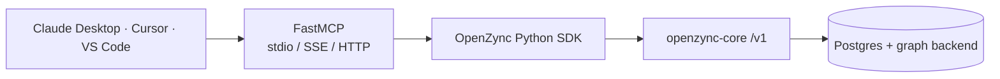

<p align="center"></p>

# OpenZync MCP Server

**Graph memory that survives production** — as tools in your MCP client.

<p align="center">
  
  <a href="./LICENSE"></a>
  <a href="https://github.com/openzync/openzync-mcp/pkgs/container/openzync-mcp"></a>
</p>

A [Model Context Protocol](https://modelcontextprotocol.io) server over [OpenZync](https://github.com/openzync/openzync-core)
that turns the agent-memory API into tools Claude Desktop, Cursor, VS Code Copilot and any MCP client
can call. [FastMCP](https://gofastmcp.com) handles transport negotiation (stdio / SSE / HTTP), schemas
and input validation; reference: [docs.openzync.tech](https://docs.openzync.tech/en/latest/domains/mcp_server.html).

[Docs](https://docs.openzync.tech/en/latest/domains/mcp_server.html) · [Core](https://github.com/openzync/openzync-core) · [Python SDK](https://github.com/openzync/openzync-python-sdk) · [Contact](mailto:rohnsha0@gmail.com)



## Tools

| Tool | What it does |
|---|---|
| `add_memory` | Add messages to your project's memory |
| `get_context` | Assemble a context block from a natural-language query |
| `search_memory` | Hybrid search across your project's memory |
| `delete_memory` | Delete all project memory (soft, confirm-gated) |
| `add_fact` | Add subject → predicate → object triples |
| `list_facts` | List facts currently valid in the graph |
| `get_fact_history` | A fact plus its invalidation lineage, newest first |
| `retract_fact` | Retract a fact without deleting its history |
| `get_user_graph` | Entity graph for the project |
| `list_observations` | Observations from graph-topology analysis |
| `list_sessions` | Sessions in the project |
| `get_session_messages` | Messages of a session, in order |
| `get_session_facts` | Facts extracted from a session, newest first |
| `list_classifications` | Dialog classifications for a session |
| `get_classification` | Classification for one episode |
| `list_structured_extractions` | Structured extractions for a session |
| `get_structured_extraction` | Structured extraction for one episode |
| `global_search` | Search across projects, users and sessions in the org |
| `create_user` | Create a user (needs `members:write`) |
| `update_project_member` | Change a member's role (needs `project:manage`) |

## Install and run

```bash
# From source — the package is distributed via git and GHCR
pip install git+https://github.com/openzync/openzync-mcp

export OPENZYN_API_KEY="oz_live_your_api_key_here"
export OPENZYN_BASE_URL="http://localhost:8000"   # or your OpenZync deployment
python -m openzync_mcp --transport stdio
```

Container — the image starts in HTTP mode on port 8100:

```bash
docker run --rm -p 8100:8100 -e OPENZYN_API_KEY=... -e OPENZYN_BASE_URL=... \
  ghcr.io/openzync/openzync-mcp:latest
```

The API key is read from `OPENZYN_API_KEY` only, never from a command-line argument — argv is
readable by every process in `ps` and lands in shell history.

### Client config

Claude Desktop (`claude_desktop_config.json`):

```json
{
  "mcpServers": {
    "openzync": {
      "command": "python",
      "args": ["-m", "openzync_mcp", "--transport", "stdio"],
      "env": {
        "OPENZYN_API_KEY": "oz_live_your_api_key_here",
        "OPENZYN_BASE_URL": "http://localhost:8000"
      }
    }
  }
}
```

Cursor takes the same `mcpServers` block in `~/.cursor/mcp.json`.

## Base URL rules

`OPENZYN_BASE_URL` (or `--base-url`) decides where the key is sent — it travels in an
`Authorization: Bearer` header on every request — so the server validates it at startup and refuses
to run on a bad one.

| Base URL | Result |
|---|---|
| `http://localhost:8000`, any `127.0.0.0/8` literal, `http://[::1]:8000` | Accepted — loopback |
| `https://<host>` | Accepted |
| `http://<host>` (non-loopback) | Rejected — use `https://` |
| Host missing from `OPENZYN_MCP_ALLOWED_HOSTS` (when set) | Rejected |

Loopback means the `localhost` name or an IP literal in `127.0.0.0/8` or `::1`; the host is parsed
as an IP, so `127.attacker.test` is a remote host and needs `https://`. `OPENZYN_MCP_ALLOWED_HOSTS`
is an optional comma-separated allowlist that also opts listed hosts into plain `http://` with a
warning — for trusted internal deployments.

Development: `make install`, then `make test` (80 % coverage gate via `make test-coverage`) and
`make lint`.

## License

Apache 2.0 — see [LICENSE](./LICENSE). Design notes are in the [MCP server docs](https://docs.openzync.tech/en/latest/domains/mcp_server.html);
if OpenZync is useful to you, a star helps others find it.
